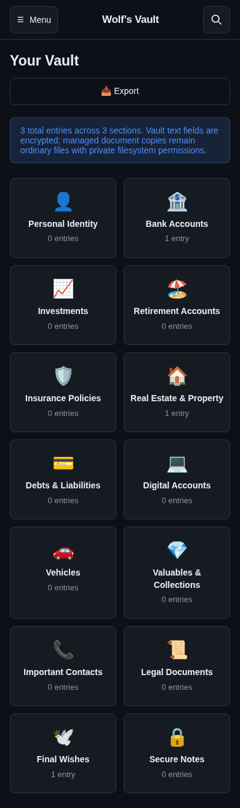

# Wolf's Legacy


Wolf's Legacy is the current estate-planning and family-continuity vault for personal records, financial account details, beneficiary access, protected final wishes, and managed document storage.

This repository reflects the current Wolf's Legacy implementation and brand set, not the older Wolf's Vault build. The visuals and packaging have been extracted and added as reusable brand assets for the project.




## What we extracted and added

The current branding package is now included under `Wolfs-Legacy-Icon-Package/brand/` and includes the extracted project artwork and export-ready assets:

- `app-icon-primary-1024.png` — primary app icon for product usage and marketing
- `app-icon-light-1024.png` — light-background app icon variant
- `app-icon-dark-1024.png` — dark-background app icon variant
- `wolf-mascot-transparent-1024.png` and `wolf-mascot-transparent-512.png` — brand mascot and avatar artwork
- `wordmark-for-light-background.png` and `wordmark-for-dark-background.png` — full Wolf's Legacy wordmark variants
- `favicon.png` — browser and shortcut icon
- `original-artwork/` — source concept artwork retained for future refinement and reuse


## Current implementation

Wolf's Legacy combines secure vault storage with practical digital legacy planning for families and executors.

### Core features

- Secure personal data vault for accounts, documents, policies, contacts, and valuables
- Beneficiary access, emergency access, and direct token handover flows
- Protected Final Wishes with review, release, and recipient workflows
- Pet Care records integrated into the existing vault structure
- Unified record-card presentation across sections and search previews
- Managed document and media handling with protected uploads and access controls
- Responsive web experience for desktop, tablet, and mobile browsers
- Audit logging, encryption, auth, backup guidance, and recovery procedures

### Recent additions and refinements

- Universal record-card redesign with contextual icons, cleaner detail hierarchy, and compact actions
- Shared presentation across ordinary vault entries, search results, beneficiary records, and personal-content cards
- Mobile and browser validation for responsive layouts and protected workflows
- Managed storage support and expanded recovery/maintenance documentation
- Branding refresh and extracted icon package for consistent Wolf's Legacy presentation

## Project status

This project is a self-hosted encrypted vault for estate planning and family continuity. It is intended to keep critical information organized, protected, and available to the right people when the time comes.

## Quick start

```bash
git clone https://github.com/Owewolf/wolfs-legacy.git
cd wolfs-legacy
cp .env.example .env
npm ci
install -d -m 700 data
npm test
npm start
```

Then open `http://localhost:4444`.

## Documentation

- [docs/branding.md](docs/branding.md) — branding and naming notes
- [docs/mobile-layout.md](docs/mobile-layout.md) — responsive browser and mobile guidance
- [docs/pet-care.md](docs/pet-care.md) — pet-care integration notes
- [docs/final-wishes-entry-flow.md](docs/final-wishes-entry-flow.md) — final wishes workflow
- [docs/legacy-recovery.md](docs/legacy-recovery.md) — operational recovery and backup guidance
- [docs/wolfs-vault-cards/README.md](docs/wolfs-vault-cards/README.md) — card redesign archive and visual references

## Project structure

```text
wolfs-legacy/
├── Wolfs-Legacy-Icon-Package/      # extracted Wolf's Legacy brand assets
├── public/                         # web app and shared front-end code
├── server/                         # API, auth, encryption, database, and vault logic
├── docs/                           # product docs, deployment notes, and screenshot archives
├── scripts/                        # maintenance, backup, and browser-validation utilities
├── tests/                          # project test suite
├── package.json
├── Dockerfile
├── LICENSE
├── SECURITY.md
└── README.md
```

## Security and use

This project is for personal planning and secure record management. It is not a substitute for professional legal or financial advice. Treat all sample data as fictional, and protect the generated secrets and backups with the same care as the vault itself.

## License

[MIT](LICENSE)
