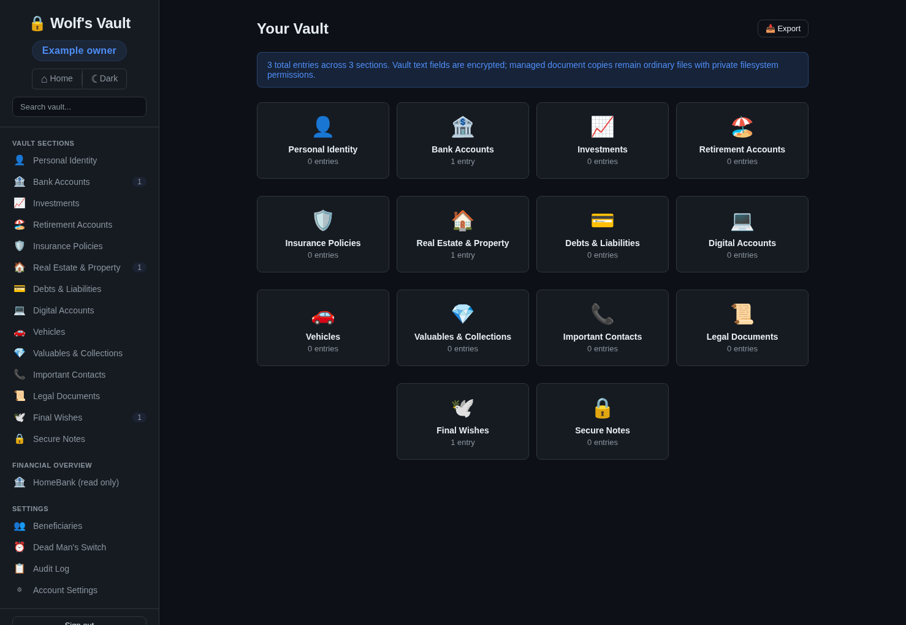

# Wolf's Vault

Application branding and compatibility details: [branding notes](docs/branding.md).

Wolf's Vault email notifications and simple email check-ins: [operations guide](docs/email-operations.md). Verify your email once, then select **Confirm I’m here** in a reminder and send the prefilled reply to reset the Dead Man’s Switch timer. This grants no vault access. Run `npm test` for the isolated regression suite. The email feature requires review and a real provider reply acceptance test before deployment.

Beneficiaries and Final Wishes now include personal letters, audio/video messages, family history, practical instructions and information reviews inside the existing sections. New records default private; recipients need both authorized beneficiary access and an explicitly released item. Existing Final Wishes fields and Wolf's Vault sharing remain compatible. See the [implementation audit](docs/beneficiaries-final-wishes-audit.md) and [deployment, migration and complete recovery guide](docs/legacy-recovery.md).

Phone and tablet browsers use compact touch navigation, readable forms and mobile document/media controls while the desktop layout stays unchanged. See the [iOS/Android layout and browser evidence](docs/mobile-layout.md).

A self-hosted, encrypted personal data vault designed for estate planning and family continuity. Store your financial accounts, legal documents, insurance policies, and final wishes in one secure place -- and ensure your family can access it when the time comes.




## Why Wolf's Vault?

When someone passes away unexpectedly, their family often faces a painful scavenger hunt: which banks had accounts? Where are the insurance policies? What are the login credentials? Who is the lawyer?

Wolf's Vault solves this by providing a single, encrypted store for all critical personal and financial information, with three secure mechanisms for your family to access it when needed.

## Features

### Vault Storage (15 Sections)
- **Personal Identity** -- IDs, passport, tax numbers
- **Bank Accounts** -- account numbers, branches, nominees
- **Investments** -- stocks, mutual funds, crypto, PPF
- **Retirement** -- EPF, NPS, pension accounts
- **Insurance** -- life, health, auto, property policies
- **Real Estate** -- property details, mortgages, deeds
- **Debts & Liabilities** -- loans, credit cards, informal debts
- **Digital Accounts** -- emails, social media, subscriptions, 2FA details
- **Vehicles** -- registration, VIN, insurance, loans
- **Valuables** -- jewelry, art, safe deposit boxes
- **Important Contacts** -- lawyer, CA, doctor, financial advisor
- **Legal Documents** -- will, power of attorney, certificates
- **Final Wishes** -- funeral, organ donation, messages to family
- **Secure Notes** -- WiFi passwords, alarm codes, anything else
- **Pet Care** -- vet details, dietary needs, rehoming plans

### Three Handover Mechanisms

1. **Dead Man's Switch** -- Set a check-in interval (e.g., 30 days). If you fail to check in within the interval plus a grace period, all beneficiaries are automatically granted access.

2. **Emergency Access Request** -- A beneficiary can request emergency access using their token. The vault owner has a configurable waiting period (1-90 days) to deny the request. If not denied, access is automatically granted.

3. **Direct Token Handover** -- Give a beneficiary their access token directly (e.g., sealed envelope with a lawyer). They can view the vault immediately if you grant access manually.

### Security
- **AES-256-GCM** encryption for vault text, protected legacy content/revisions and document metadata at rest
- Managed document/media bytes are plaintext files protected by ownership and `0700` directories/`0600` files; use encrypted storage for binary encryption
- **bcrypt** (cost 12) password hashing
- **JWT** authentication with 24-hour expiry
- **Rate limiting** on auth and sensitive endpoints
- **Helmet.js** security headers with strict CSP
- **Audit logging** for all security-relevant actions
- Beneficiary tokens are SHA-256 hashed before storage
- Token expiration (2-year lifetime)
- Transaction-based auto-grant to prevent race conditions

### User Experience
- Dark and light theme with toggle
- Global search across all encrypted entries
- Export vault as printable HTML document
- Export/import ordinary vault entries as JSON; complete stopped snapshots preserve protected content, media, mappings, history, keys and mail state
- Toast notifications and loading states
- Onboarding guide for new users
- Responsive design for mobile

## Quick Start

### From source on Fedora/Linux

Use a supported Node.js installation and the native build prerequisites for `better-sqlite3` (`gcc-c++`, `make`, `python3` on Fedora). Local verification uses Node.js 24.

```bash
git clone https://github.com/Owewolf/wolfs-legacy.git
cd wolfs-legacy
cp .env.example .env
npm ci
install -d -m 700 data
# Prepare the verified managed directory for the wolf service account.
sudo install -d -o wolf -g "$(id -gn wolf)" -m 700 \
  /srv/data/files/legacy-vault-managed-documents
npm test
npm start
```

Open `http://localhost:4444`. For systemd, use the existing `scripts/setup-systemd.sh` renderer/validator and follow the [deployment runbook](docs/legacy-recovery.md#fedora-service-and-migration). Back up the stopped database, files and matching keys before the first upgraded startup; schema migration is additive and automatic at initialization. Existing Docker files are inherited deployment scaffolding and need their port, private managed-storage mount and service-user permissions reviewed before use with this feature.

### Configuration

Edit `.env` to customize:

```env
PORT=4444

# Leave as 'auto' to generate and persist secrets automatically on first run.
# Or set your own values (JWT_SECRET: any string 32+ chars, ENCRYPTION_KEY: 64-char hex).
JWT_SECRET=auto
ENCRYPTION_KEY=auto
DOCUMENT_STORAGE_ROOT=/srv/data/files/legacy-vault-managed-documents
DOCUMENT_MAX_FILE_MB=25
LEGACY_STORAGE_QUOTA_MB=2048
NOTIFICATIONS_ENABLED=false
```

On first startup, if set to `auto`, the server generates cryptographically secure secrets and persists them to `data/.secrets`. These keys encrypt your vault data -- **back them up** and **never expose them**.

Protected uploads accept MP3 (`audio/mpeg`), M4A (`audio/mp4`), WAV (`audio/wav`), MP4 (`video/mp4`) and MOV (`video/quicktime`) alongside the existing document/image types. Server signature/container validation, generated names, file/request/owner limits and authenticated byte ranges protect playback and download. Browser codec support determines in-app playback; download remains available. New protected photo uploads remove incidental metadata, including GPS/EXIF, without changing selected originals. New Markdown rendering excludes executable HTML, unsafe links and remote images.

## Demo Data

Seed the vault with fictional sample data to explore all features:

```bash
# 1. Register a user
curl -s -X POST http://localhost:4444/api/auth/register \
  -H "Content-Type: application/json" \
  -d '{"name":"Demo User","email":"demo@example.com","password":"DemoPass123!"}'

# 2. Copy the token from the response, then run:
./seed.sh <paste-token-here>
```

> All data in `seed.sh` is entirely fictional. See the disclaimer at the top of the file.

## Project Structure

```
wolfs-legacy/
├── server/
│   ├── index.js              # Express app, middleware, dead switch scheduler
│   ├── config.js             # Auto-generates and persists secrets
│   ├── crypto.js             # AES-256-GCM encrypt/decrypt
│   ├── db.js                 # SQLite schema, migrations, audit helper
│   ├── logger.js             # Structured JSON logging
│   ├── validate.js           # Input validation utilities
│   ├── middleware/
│   │   └── auth.js           # JWT authentication middleware
│   └── routes/
│       ├── auth.js           # Register, login, password change
│       ├── vault.js          # CRUD, search, export, backup/restore
│       ├── beneficiaries.js  # Add/remove, grant/revoke, emergency access
│       └── deadswitch.js     # Status, config, check-in
├── public/
│   ├── index.html            # SPA shell
│   ├── css/
│   │   └── style.css         # Dark/light theme, all components
│   └── js/
│       ├── api.js            # API client
│       ├── app.js            # SPA router, views, UI logic
│       └── sections.js       # Vault section definitions and field schemas
├── Dockerfile                # Node 22 Alpine, healthcheck
├── docker-compose.yml        # Single-service with volume mounts
├── backup.sh                 # SQLite backup with integrity check and retention
├── seed.sh                   # Demo data seeder (all fictional)
├── .env.example              # Environment template
├── package.json
├── LICENSE
└── SECURITY.md
```

## API Reference

All endpoints except auth and beneficiary access require a JWT token in the `Authorization: Bearer <token>` header.

### Authentication
| Method | Endpoint | Description |
|--------|----------|-------------|
| POST | `/api/auth/register` | Create account |
| POST | `/api/auth/login` | Sign in |
| GET | `/api/auth/me` | Get current user |
| PUT | `/api/auth/password` | Change password |

### Vault Entries
| Method | Endpoint | Description |
|--------|----------|-------------|
| GET | `/api/vault/entries?section=&page=` | List entries (paginated) |
| GET | `/api/vault/entries/:id` | Get single entry |
| POST | `/api/vault/entries` | Create entry |
| PUT | `/api/vault/entries/:id` | Update entry |
| DELETE | `/api/vault/entries/:id` | Delete entry |
| GET | `/api/vault/summary` | Entry counts by section |
| GET | `/api/vault/search?q=` | Search across all entries |
| GET | `/api/vault/export` | Export all entries (decrypted) |
| GET | `/api/vault/backup` | Export ordinary vault entries and summary metadata (JSON) |
| POST | `/api/vault/restore` | Import ordinary vault entries |

### Beneficiaries
| Method | Endpoint | Description |
|--------|----------|-------------|
| GET | `/api/beneficiaries` | List beneficiaries |
| POST | `/api/beneficiaries` | Add beneficiary |
| DELETE | `/api/beneficiaries/:id` | Remove beneficiary |
| POST | `/api/beneficiaries/:id/grant` | Grant access |
| POST | `/api/beneficiaries/:id/revoke` | Revoke access |
| POST | `/api/beneficiaries/:id/deny-emergency` | Deny emergency request |
| POST | `/api/beneficiaries/:id/regenerate-token` | Issue new token |
| POST | `/api/beneficiaries/emergency-access` | Request emergency access (no auth) |
| POST | `/api/beneficiaries/access` | Access vault with token (no auth) |

### Protected Final Wishes and recipient content

Owner routes use the existing owner Bearer JWT. Recipient routes use the **existing beneficiary token** in `Authorization: Bearer ...`; credentials never go in media URLs. Every direct read and byte-range request checks current token, grant, recipient mapping and item release.

| Method | Endpoint | Description |
|--------|----------|-------------|
| GET, POST | `/api/final-wishes/legacy` | Filter/list or create protected content |
| GET, PATCH, DELETE | `/api/final-wishes/legacy/:id` | Read/edit or archive an owner item |
| PUT | `/api/final-wishes/legacy/:id/beneficiaries` | Assign existing recipients |
| POST | `/api/final-wishes/legacy/:id/release` | Explicit confirmed manual release |
| POST | `/api/final-wishes/legacy/:id/revoke` | Explicit selected-recipient revocation |
| POST | `/api/final-wishes/legacy/:id/review` | Review, reschedule, snooze or disable |
| GET | `/api/final-wishes/reviews/due` | Owner due/overdue review list |
| POST | `/api/final-wishes/legacy/:id/attachments` | Upload files or associate a protected managed copy |
| DELETE | `/api/final-wishes/legacy/:id/attachments/:attachmentId` | Unlink a managed copy |
| GET | `/api/final-wishes/legacy/:id/attachments/:attachmentId/content` | Owner preview/download/range |
| GET | `/api/beneficiaries/:id/legacy` | Owner recipient-specific content view |
| GET | `/api/beneficiary-access/legacy` | Authorized released recipient list/search |
| GET | `/api/beneficiary-access/legacy/:id` | Authorized recipient item |
| GET | `/api/beneficiary-access/legacy/:id/attachments/:attachmentId/content` | Authorized recipient preview/download/range |
| POST | `/api/beneficiary-access/legacy/:id/acknowledgements` | Acknowledge an instruction step separately from canonical text |

The existing notification worker sends generic review emails only to the owner's verified address. Review actions never reset check-in or alter the five expiry reminders. Recipient availability is shown in the protected interface; there is no automatic confidential-content email.

### Dead Man's Switch
| Method | Endpoint | Description |
|--------|----------|-------------|
| GET | `/api/deadswitch/status` | Get switch status and deadlines |
| PUT | `/api/deadswitch/config` | Update interval, grace, active state |
| POST | `/api/deadswitch/checkin` | Check in (reset timer) |

### Other
| Method | Endpoint | Description |
|--------|----------|-------------|
| GET | `/api/audit?page=` | Audit log (paginated) |
| GET | `/health` | Health check (DB connectivity) |

## Backups

For complete recovery, use [the stopped snapshot and disposable restore procedure](docs/legacy-recovery.md#complete-stopped-snapshot). `scripts/backup-managed.sh --service-stopped /new/external/snapshot` now discovers this checkout, copies database/media/keys/configuration, and verifies SQLite integrity, authenticated decryption and managed-file checksums. Optional effective service-unit output can be included. `scripts/managed-recovery.js restore` creates an independent quarantined copy without starting workers. The database-only and JSON exports below do not preserve the complete expanded vault.

Run `node scripts/maintenance-legacy-storage.js --database /absolute/app/data/vault.db --storage-root /absolute/managed/root` to report abandoned uploads and untracked generated copies older than 24 hours. The [maintenance procedure](docs/legacy-recovery.md#storage-maintenance) documents the separate stopped-service purge flags; tracked managed copies and selected originals are preserved.

### Automated Database Backup

```bash
# Run manually
./backup.sh

# Or schedule via cron (daily at 2 AM, keep 30 backups)
0 2 * * * /path/to/wolfs-legacy/backup.sh /path/to/backups 30
```

The script uses SQLite's `.backup` command for safe, consistent copies even with WAL mode active, verifies integrity, and prunes old backups beyond the retention count.

### Application-Level Backup

From the UI: **Account Settings > Download vault entries (JSON)** creates a JSON file with decrypted ordinary vault entries, beneficiary list and switch metadata. **Restore vault entries (JSON)** imports entries only. Protected legacy records/revisions, recipient/release history, files, notification state and secrets require the complete operational snapshot.

> Database backups preserve encrypted data. Application backups contain decrypted data -- handle them with the same care as the vault itself.

## Tech Stack

| Component | Technology |
|-----------|-----------|
| Runtime | Node.js 22 (Alpine) |
| Framework | Express 5 |
| Database | SQLite (better-sqlite3) with WAL mode |
| Encryption | AES-256-GCM (Node.js crypto) |
| Auth | JWT + bcrypt |
| Frontend | Vanilla JS SPA |
| Container | Docker (Alpine) |

## Built With Claude

This project was vibe coded entirely with [Claude](https://claude.ai/) by Anthropic -- from architecture and backend logic to frontend UI and Docker setup. Every line of code, the database schema, encryption layer, and even this README were generated through natural language conversation with Claude.

## Contributing

Contributions are welcome. Please:

1. Fork the repository
2. Create a feature branch
3. Make your changes
4. Ensure no secrets or real personal data are included
5. Open a pull request

See [SECURITY.md](SECURITY.md) for security-related guidelines.

## License

[MIT](LICENSE)

---

> **Disclaimer**: Wolf's Vault is a personal project. It is not a substitute for professional estate planning, legal counsel, or financial advice. Use at your own risk. All sample data in this repository is entirely fictional.
